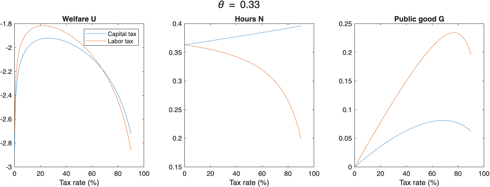
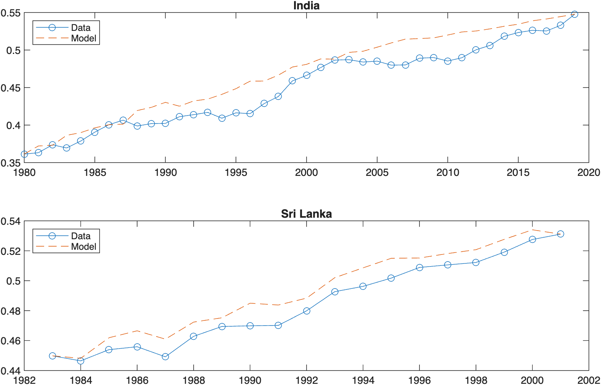

# Taxation, Automation and Structural Change — Quantitative Macroeconomics in MATLAB

> Master's degree group project — *N.F. and co-authors*
> All rights reserved. See `LICENSE` for details.

---

## Overview

Two exercises, solved in MATLAB:

1. **Tax labor, or tax the robots?** A steady-state growth model with endogenous labor and a productive public good financed by taxes on capital and labor. We look for the welfare-maximizing tax rates, compare a worker and a capitalist, and redo everything after automation raises the capital share (θ from 0.33 to 0.40).
2. **Richer, or pricier?** A two-sector model (goods and services) with a subsistence term on goods, calibrated jointly on **India (1980–2019)** and **Sri Lanka (1983–2001)**: four moments pin down four parameters, the years in between are used as a test, and the rise of services is split into an income effect and a relative-price effect.

The full write-up is in [`report/problem_set_2_report.pdf`](report/problem_set_2_report.pdf).

---

## Project Structure

```
.
├── ex1/
│   ├── ex1_steady_state_ps.m   # Function: steady state for given theta and tax rates
│   ├── ex1d_ps.m               # One tax at a time
│   ├── ex1e_ps.m               # Both taxes together
│   ├── ex1g_ps.m               # Worker vs capitalist
│   ├── ex1i_ps.m               # Parts (h)-(i)
│   ├── ex1j_ps.m               # Automation: before vs after
│   └── ex1k_ps.m               # Worker's labor tax with a capital tax in the background
├── ex2/
│   ├── ex2_ps.m                # Main script for Exercise 2
│   ├── share_model.m           # Function: services share in the model
│   ├── calib2.m                # Function: calibration equations for fsolve
│   └── PS2_Ex2_data.csv        # Data
├── report/problem_set_2_report.pdf
└── figures/
```

---

## Exercise 1 — Tax labor, or tax the robots?



Every script has `theta = 0.33` at the top; set it to `0.40` and run again to see the economy after automation.

## Exercise 2 — Richer, or pricier?



---

## Requirements

- MATLAB R2020a or later, with the Optimization Toolbox (`fsolve`)

## Usage

Open the `ex1` or `ex2` folder in MATLAB and run any script. Figures stay on screen; results are printed in the Command Window.

---

## License

This project is protected by copyright. See the [`LICENSE`](LICENSE) file for full terms.
**Reusing, copying, modifying, or redistributing** the code without explicit written permission from the authors is not permitted.
